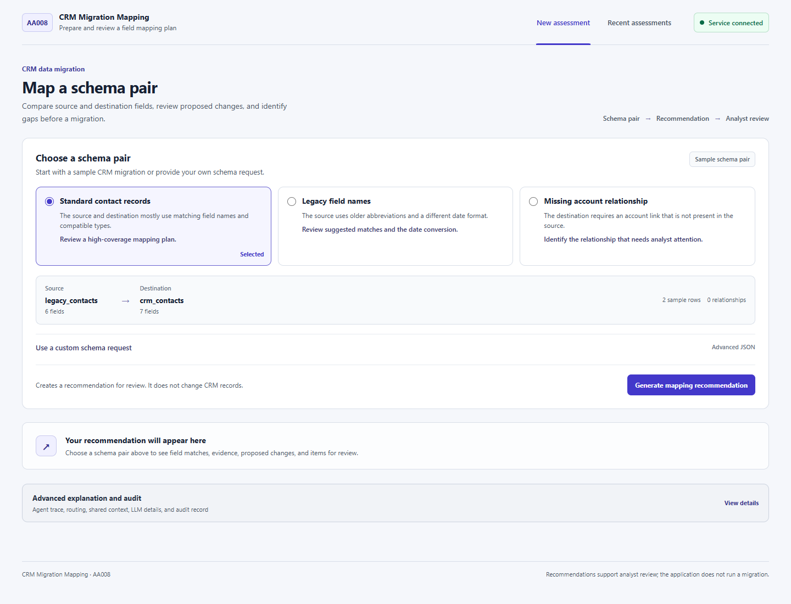
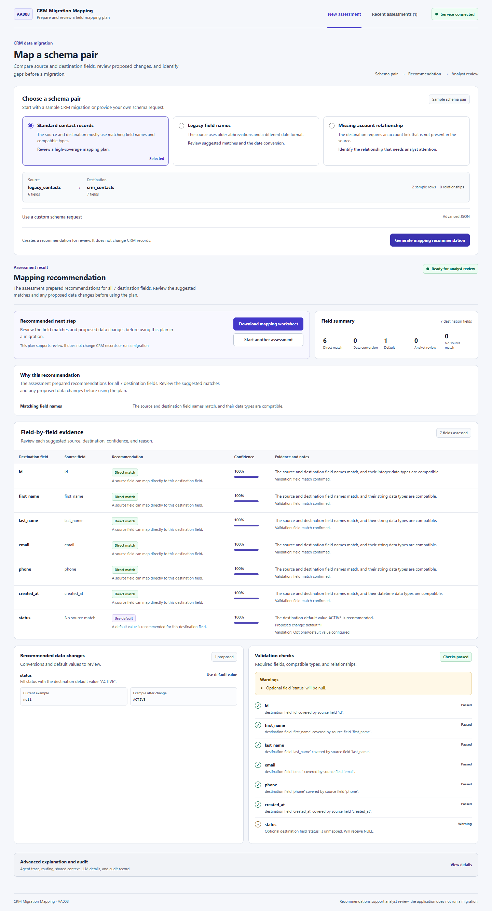
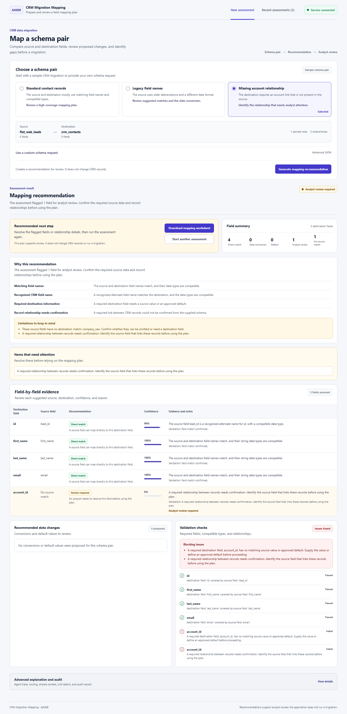
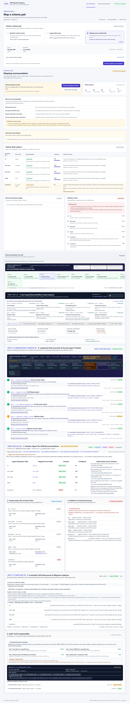
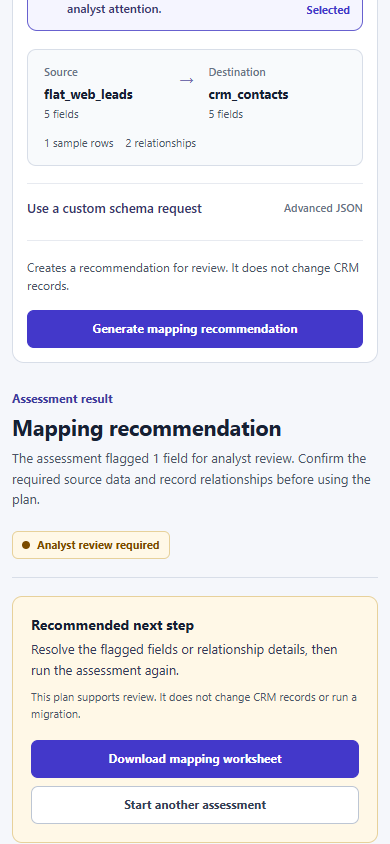

# AA008 — CRM Data Migration Mapping Intelligence

> **RealRails Agentic AI Internship (Batch 2) — Phase 3 Final Demo & Portfolio Package**  
> An explainable decision-support system that reconciles legacy CRM schemas with target destination schemas using deterministic rules, LangGraph state orchestration, conditional routing, and a controlled LLM narrative layer.

---

## Business Problem

When enterprises migrate customer records across CRM systems (e.g., legacy databases to Salesforce or HubSpot), schemas rarely align 1:1. Migration teams encounter:
- **Inconsistent field nomenclature:** (e.g., `cust_first_name` vs. `first_name`).
- **Data type incompatibilities:** (e.g., ISO string timestamps requiring conversion to ISO-8601 UTC datetimes).
- **Missing required fields:** Mandatory target fields absent from source extracts.
- **Relational integrity breaks:** Unresolvable foreign-key relationships (e.g., `contact.account_id` referencing a missing `crm_accounts` table).

Manual spreadsheet mapping is slow, error-prone, and lacks auditable rationale.

> [!IMPORTANT]
> **Boundary Notice:** AA008 is a decision-support and mapping intelligence engine. It evaluates schema metadata and sample records to produce a reviewable migration plan. It **never writes to production CRM systems or databases**.

---

## What the Product Does

AA008 evaluates source and destination schema definitions, relationship constraints, and sample rows to produce a structured migration blueprint:
1. **Per-Field Action Planning:** Deterministically categorizes fields into `DIRECT_MAP`, `TRANSFORM`, `DEFAULT`, `UNMAPPED`, or `REVIEW`.
2. **Authoritative Migration Readiness:** Issues an overall status (`READY` vs. `NEEDS_REVIEW`) and routing verdict.
3. **Automated Transformation Specs:** Generates explicit conversion plans (e.g., string date parsing, datetime casting).
4. **Exception Triage:** Flags missing mandatory attributes and broken relational keys for human review.
5. **Controlled LLM Advisory:** Generates executive summaries, risk ratings, and triage checklists under strict Pydantic validation without authority over mapping decisions.
6. **Execution Trace & Audit Trail:** Exposes the full LangGraph node trace, triggered business rules, and exportable CSV mapping worksheet.

**Primary Users:** CRM Migration Analysts, Data Engineers, and CRM Implementation Leads.

---

## Architecture

The system executes a deterministic-first, graph-orchestrated workflow where business rules and constraints govern all decisions, and the LLM acts purely as a bounded communication and rationale layer.

```text
Business Input
  │
  ▼
Vite + React UI  (Business Workspace / Explainability & Audit Drawer / CSV Export)
  │  HTTP / JSON
  ▼
FastAPI Application Layer  (Endpoints: /api/migrate, /api/scenarios, /health)
  │
  ▼
┌────────────────────────────────────────────────────────────────────────┐
│                      LangGraph StateGraph Workflow                     │
│                                                                        │
│  [START]                                                               │
│     │                                                                  │
│     ▼                                                                  │
│  1. context_validation    (Validates schemas, builds WorkflowState)    │
│     │                                                                  │
│     ▼                                                                  │
│  2. schema_analyzer       (Schema Analyzer Agent: profiles types/keys) │
│     │                                                                  │
│     ▼                                                                  │
│  3. field_mapper          (Field Mapping Agent: exact/alias matching)  │
│     │                                                                  │
│     ▼                                                                  │
│  4. transformer           (Transformation Agent: plans type casts)     │
│     │                                                                  │
│     ▼                                                                  │
│  5. validator             (Validation Agent: audits coverage & FKs)    │
│     │                                                                  │
│     ▼                                                                  │
│  6. decision              (Migration Decision Agent: rules & status)   │
│     │                                                                  │
│     ├────────────────── Deterministic Conditional Router ──────────────┤
│     │                                                                  │
│     ├─── HIGH_CONFIDENCE ──────────► 7a. direct_accept                 │
│     ├─── TRANSFORM_REQUIRED ───────► 7b. transform_verify              │
│     └─── REVIEW_REQUIRED ──────────► 7c. human_review                  │
│                                              │                         │
│     ┌────────────────────────────────────────┘                         │
│     ▼                                                                  │
│  8. llm_enhancement       (Controlled narrative & risk advisory)       │
│     │                     [Deterministic Fallback Guardrail]           │
│     ▼                                                                  │
│  9. explainer             (Migration Explainer: rule-based evidence)   │
│     │                                                                  │
│     ▼                                                                  │
│  10. audit                (Audit Store: logs trace to in-memory store) │
│     │                                                                  │
│  [END]                                                                 │
└────────────────────────────────────────────────────────────────────────┘
```

### Business Input
Accepts structured schema definitions containing table names, column specifications (`name`, `data_type`, `nullable`, `is_primary_key`, `is_foreign_key`), sample rows, and relationship constraints.

### Specialized Domain Agents
1. **Schema Analyzer Agent:** Profiles schema structures, detects key types, and maps foreign-key dependencies.
2. **Field Mapping Agent:** Matches source and destination fields using normalized exact names and known alias dictionaries.
3. **Transformation Agent:** Evaluates sample rows and type compatibility to plan necessary conversions (e.g., string date parsing).
4. **Validation Agent:** Audits mandatory target field coverage and verifies relationship integrity.
5. **Migration Decision Agent:** Synthesizes matches, transforms, and validation flags into structured per-field recommendations.

### LangGraph Topology
A compiled `StateGraph` with **12 nodes defined** (6 linear pipeline nodes, 3 conditional branch nodes, 1 controlled LLM enhancement node, 1 explanation node, and 1 audit node). Exactly **10 nodes execute per run**. State is preserved in an immutable, typed `WorkflowState`.

### Deterministic Conditional Routing
Evaluated by `route_after_decision` immediately following the decision node:
- **`route_direct_accept` (HIGH_CONFIDENCE):** 100% target field coverage with compatible types (Rules 1 & 2), 0 type transformations, and 0 constraint violations. Outcome: `ACCEPTED_DIRECT` (`READY`).
- **`route_transform_verify` (TRANSFORM_REQUIRED):** 1+ fields require type conversion or formatting (Rule 3), 0 blocking constraint violations. Outcome: `TRANSFORM_STAGED` (`READY`).
- **`route_human_review` (REVIEW_REQUIRED):** 1+ items flagged for review, missing required fields (Rule 4), or broken foreign-key relationships (Rule 5). Outcome: `ESCALATED_FOR_REVIEW` (`NEEDS_REVIEW`).

### Decision Rules
- **Rule 1 (Confidence 100%):** Exact normalized name + compatible type → `DIRECT_MAP`.
- **Rule 2 (Confidence 90%):** Known alias + compatible type → `DIRECT_MAP` with alias evidence.
- **Rule 3 (Confidence 70%):** Convertible data types → `TRANSFORM` with transformation plan.
- **Rule 4 (Confidence 0%):** Required target field missing source or default → `REVIEW` (blocking issue).
- **Rule 5 (Confidence 0%):** Relational constraint or foreign-key discrepancy → `REVIEW` (blocking issue).

### Controlled LLM Enhancement & Fallback
- **Strict Role Boundary:** Generates plain-language executive summaries, transformation rationales, and triage checklists.
- **Zero Decision Authority:** The LLM cannot alter field mappings, change confidence scores, modify routing decisions, or overturn validation results.
- **Pydantic Validation:** All output conforms to `LLMEnhancementOutput`, rejecting hallucinated keys or non-conforming structures.
- **Deterministic Fallback:** If the LLM provider fails, times out, is disabled (`LLM_ENABLED=false`), or returns invalid output, the system automatically uses deterministic rule-based explanations without interrupting the workflow.

### Explanation & Audit Trail
- **Run-Scoped Workflow Context:** Unique `workflow_id` binds all agent outputs, decisions, and telemetry.
- **Node Execution Trace:** Step-by-step telemetry capturing node name, agent title, status, and timestamp.
- **In-Memory Audit Store:** Queryable audit log of recent assessments, routing reasons, triggered rules, and telemetry.

---

## Technical Evolution

| Milestone | Stage | Implemented Technical Evolution |
|---|---|---|
| **Phase 1 / 1.2** | Deterministic Baseline | Five domain agents, explicit Pydantic schemas, and deterministic matching rules (Rules 1–5 with confidences 100/90/70/0/0). |
| **Phase 2** | LangGraph Orchestration | Replaced sequential procedural code with a LangGraph `StateGraph`, introducing structured state transitions and execution tracing. |
| **Phase 2.2** | Conditional Routing | Replaced linear graphs with dynamic routing (`route_after_decision`), enabling branching into direct acceptance, transformation verification, and human triage. |
| **Phase 2.3** | Controlled LLM Enhancement | Introduced a bounded LLM advisory layer (Gemini / Mock) with strict Pydantic validation and deterministic rule fallback. |
| **Phase 3 / 3.2** | Productization & Portfolio | Built a polished business interface, dual-mode Explainability & Audit drawer, CSV worksheet export, responsive layout, and end-to-end verification suite. |

---

## Key Features

- **Interactive Schema Input:** Test pre-loaded seeded scenarios or submit custom JSON schemas.
- **Migration Readiness Banner:** Immediate visibility into readiness (`READY` vs. `NEEDS_REVIEW`) and routing branch.
- **Field-by-Field Mapping Matrix:** Clear breakdown of mapping actions, confidence levels, source/target data types, and rule citations.
- **Transformation Blueprint:** Concrete technical specifications for string parsing, date formatting, and type casts.
- **Constraint & Exception Triage:** Explicit identification of missing mandatory columns and broken foreign keys.
- **Controlled LLM Advisory Panel:** Executive summaries, risk classifications (LOW / MEDIUM / HIGH), and analyst action items with fallback indicators.
- **Explainability & Audit Drawer:** Visual 10-node execution timeline, raw state viewer, latency telemetry, and triggered rules.
- **CSV Worksheet Export:** Download an offline mapping worksheet (`mapping-worksheet-<workflow_id>.csv`) for human sign-off.

---

## Demo Scenarios

| Scenario | Reproduction Steps | Implemented Evidence |
|---|---|---|
| **Scenario 1: Normal Business Case** | Select `simple_schema`, click **Run 5-Agent Migration Pipeline**. | `READY` (`ACCEPTED_DIRECT`), 100% confidence direct mappings under Rule 1, 0 transforms, 0 reviews, full audit trace. |
| **Scenario 2: Meaningful Exception** | Select `relationship_mismatch`, click **Run 5-Agent Migration Pipeline**. | `NEEDS_REVIEW` (`ESCALATED_FOR_REVIEW`), missing FK `account_id` referencing `crm_accounts`, blocking constraint evidence under Rules 4 & 5. |
| **Scenario 3: Controlled LLM & Fallback** | Select `naming_mismatch` with `$env:LLM_ENABLED="true"` (or `"false"` for fallback), run pipeline. | `READY` (`TRANSFORM_STAGED`), Rules 2 & 3. When `LLM_ENABLED="false"`, LLM telemetry shows `SKIPPED` and deterministic fallback narrative is served seamlessly. |

---

## Technology Stack

- **Backend & Orchestration:** Python 3.13, FastAPI, Pydantic v2, LangGraph, Uvicorn, HTTPX
- **Frontend & UI:** React 19, TypeScript, Vite 8, Lucide React, Custom CSS Design System
- **Testing & Verification:** pytest (29 tests passing), Starlette TestClient, E2E validation script
- **Packaging & Deployment:** Docker, Docker Compose, Vercel (Frontend), Render (Backend)

---

## Run Locally

Run backend and frontend concurrently in two PowerShell terminals:

### 1. Backend Service (Terminal 1)
```powershell
Set-Location "phase3/backend"
python -m venv .venv
.\.venv\Scripts\Activate.ps1
pip install -r requirements.txt

# Configure mock provider for zero-dependency local execution
$env:LLM_PROVIDER = "mock"
$env:LLM_ENABLED = "true"

uvicorn app.main:app --reload --port 8000
```
*Health Check:* Open `http://localhost:8000/health` in your browser.

### 2. Frontend Interface (Terminal 2)
```powershell
Set-Location "phase3/frontend"
npm install
$env:VITE_API_BASE_URL = "http://localhost:8000"
npm run dev
```
*Application Access:* Open the local Vite URL (typically `http://localhost:5173`) in your browser.

> [!TIP]
> **Testing Deterministic Fallback:** In the backend terminal, set `$env:LLM_ENABLED = "false"` and restart `uvicorn`. Run any scenario to observe deterministic rule fallback in action.

---

## Cloud Deployment

| Service | Endpoint | Status | Notes |
|---|---|---|---|
| **Frontend** | [frontend-ten-ebon-33.vercel.app](https://frontend-ten-ebon-33.vercel.app) | Live | Earlier Phase 2 workflow deployment. Synchronize local Phase 3 UI before production review. |
| **Backend API** | [Render Health Check](https://case-id-aa008-crm-data-migration-mapping.onrender.com/health) | Live (Checked 2026-10-11) | Responds with HTTP 200 `{"status": "healthy", "case_id": "AA008"}`. |

> [!NOTE]
> **Deployment State Disclosure:** The deployed cloud frontend currently serves the earlier Phase 2 workflow UI. The screenshots, Explainability & Audit drawer, and polished layout documented here reflect the local Phase 3 product codebase.

---

## Screenshots

The following screenshots capture the verified local Phase 3 user interface (`docs/phase3/screenshots/`):

1. **Main Business Workspace & Schema Configuration:**  
     
   *Scenario selection, schema cards, and pipeline trigger.*

2. **High-Confidence Direct Recommendation (`READY`):**  
     
   *Scenario 1 direct-map outcome, summary metrics, and field mapping breakdown.*

3. **Exception Escalation & Review Required (`NEEDS_REVIEW`):**  
     
   *Scenario 2 blocking relationship errors, missing required fields, and triage checklist.*

4. **10-Step LangGraph Execution Trace & Audit Inspector:**  
     
   *Full node telemetry, LLM risk advisory, raw state JSON, and CSV export.*

5. **Responsive Mobile & Narrow-Viewport Layout:**  
     
   *Adaptive single-column view ensuring usability across screen sizes.*

---

## Limitations & Non-Goals

- **No Database Execution:** AA008 produces schema mapping blueprints; it never writes to databases or migrates customer records.
- **Decision Support, Not Autonomous Authority:** Recommendations highlight issues and propose actions for human analyst sign-off.
- **Process-Scoped Audit Persistence:** In the current MVP, audit history and execution traces are retained in server memory and reset upon restart.
- **Seeded Sample Coverage:** Demonstration datasets reflect standard CRM patterns; production deployment requires tuning for proprietary schema dialects.
- **No Direct Third-Party CRM Connectors:** Live OAuth connectors to Salesforce/HubSpot are outside this phase's scope.
- **No Formal Compliance Certifications:** Demonstrates architectural guardrails, not third-party compliance or security certifications.

---

## Future Improvements

1. **Cloud Production Sync:** Push Phase 3 UI code to the linked GitHub repository and deploy the updated bundle to Vercel.
2. **Persistent Audit Storage:** Upgrade the in-memory audit store to PostgreSQL or SQLite for long-term audit history.
3. **Schema File Upload:** Add drag-and-drop CSV, DDL, and JSON schema file ingestion to the input interface.
4. **Interactive Mapping Editor:** Allow analysts to manually override suggested mappings directly in the UI with instant re-validation.

---

## Portfolio Materials

- **[Timed Demo Script](DEMO_SCRIPT.md):** 2–3 minute timed presentation guide.
- **[Case Submission Summary](CASE_SUBMISSION.md):** Submission metadata, checklists, and test results.
- **[Product Bible](docs/Product_Bible/AA008_CRM_Data_Migration_Mapping_Intelligence_Product_Bible.md):** Authoritative domain specification.
- **[Latest Repomix Snapshot](repomix-output.xml):** Full codebase snapshot (102 files packed).
- **[GitHub Repository](https://github.com/ajks5/case-id-AA08-CRM-Data-migration-mapping-inteligence):** Source code repository.
